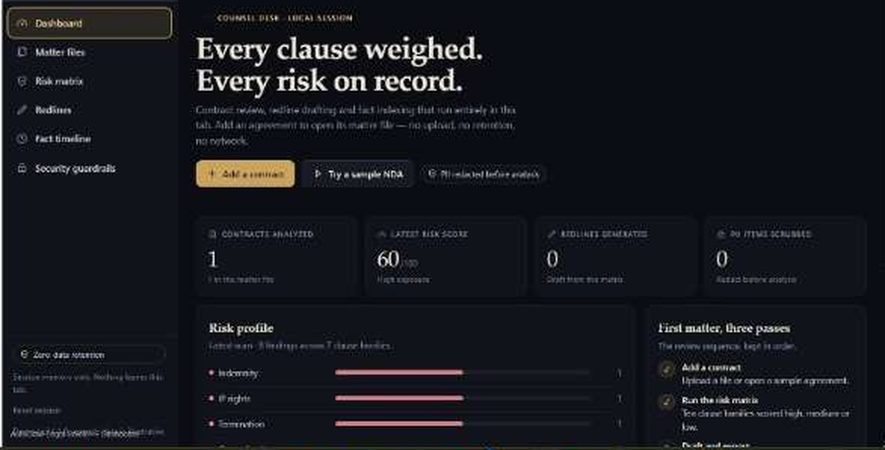
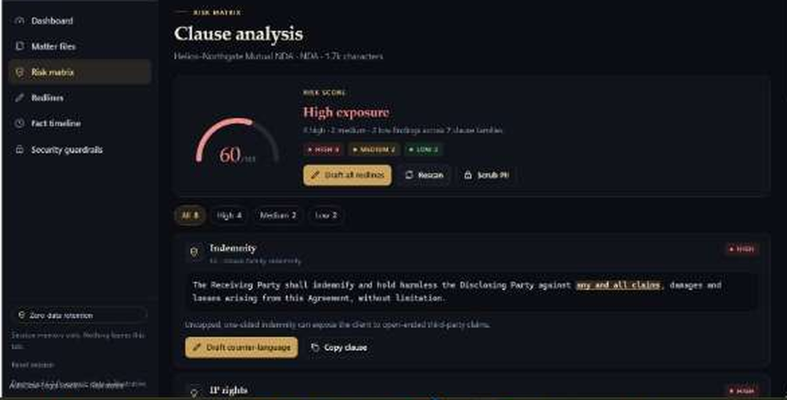
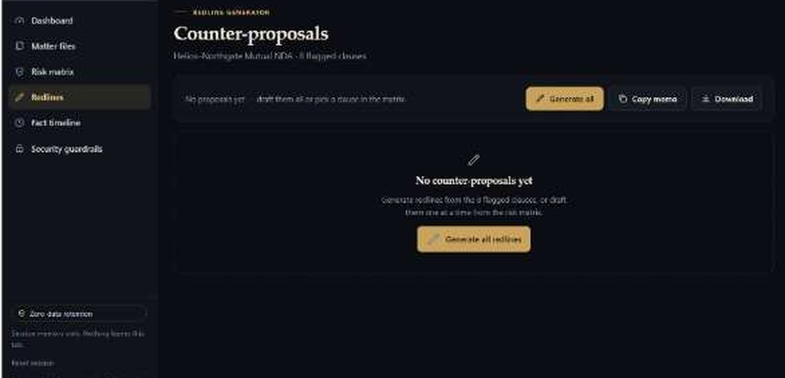
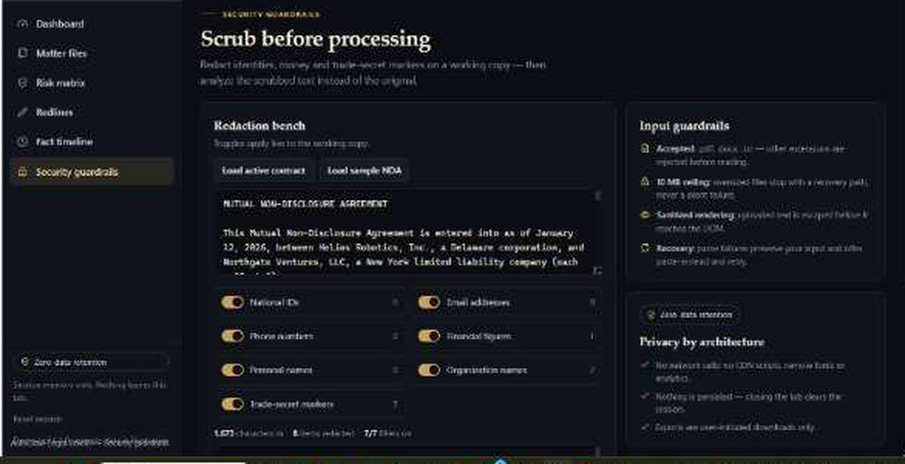

<div align="center">

# AutoClaw Legal Shield ⚖️🛡️

**Enterprise-grade, zero-telemetry, client-side legal intelligence — contract review, automated redlining, risk matrices, and matter-file organization in one self-contained HTML file.**

[](https://autoclaw.z.ai/)
[](https://autoclaw.z.ai/)
[](LICENSE)
[](SECURITY.md)
[](https://drive.google.com/file/d/1q2BBAbNKf0_X0_0EgDh8yPTnl4kzdCUw/view?usp=sharing)

</div>

---

## 🎬 Demo Walkthrough

▶️ **[Watch the full product walkthrough →](https://drive.google.com/file/d/1q2BBAbNKf0_X0_0EgDh8yPTnl4kzdCUw/view?usp=sharing)**

The recording covers the complete review cycle: loading a sample agreement → deterministic risk scan → redline generation → fact timeline export → PII scrubbing — all inside a single browser tab with no network activity.

---

## 🚀 Overview & Purpose

Manual contract review is slow, expensive, and vulnerable to oversight. **AutoClaw Legal Shield** delivers an instant, autonomous, secure legal workbench for lawyers, in-house counsel, and solopreneurs. It ingests local files, parses clause families, calculates deterministic risk scores, generates robust counter-proposals, builds chronological fact timelines, and scrubs PII — with zero data retention.

---

## 📸 Project Showcase

### 1. Executive Dashboard & Risk Matrix

*Exposure KPIs (contracts analyzed, latest risk score, redlines generated, PII scrubbed), a clause-family risk profile, and the deterministic severity distribution — the sample NDA resolves to **4 High · 2 Medium · 2 Low = 8 findings**.*

[](docs/screenshots/dashboard_risk.png)

[](docs/screenshots/risk_matrix.png)

### 2. Automated Redline & Counter-Proposal Generator

*One-click counter-language for every flagged clause, with inline strike/insert redlines on risky spans, proposal-only fallbacks for already-compliant text, adoption tracking, and a downloadable redline memorandum.*

[](docs/screenshots/redlines.png)

### 3. PII Redaction Bench & Security Guardrails

*Client-side scrubbing for national IDs, emails, phone numbers, financial figures, personal and organization names, and trade-secret markers — live redaction counts, a preview pane, and one-click analysis of the scrubbed copy.*

[](docs/screenshots/security_guardrails.png)

---

## 🛠️ Key Features & Workflows

| Workflow | What it does |
|---|---|
| **Matter intake** | Drag-drop, file picker, or paste; PDF/DOCX/TXT validated by extension and a 10 MB cap before any read. Four illustrative sample agreements included (NDA, employment, SaaS subscription, vendor SLA). |
| **Risk matrix** | Ten clause families scored deterministically (indemnity, limitation of liability, termination, governing law, IP rights, confidentiality, auto-renewal, fees & penalties, non-compete, data & trade secrets) with severity badges, per-clause rationale, and section-accurate locations (`§3`, `§7`). |
| **Redline generator** | Balanced counter-language per finding, inline `del/ins` redlines, adoption toggles, copy/download memorandum. |
| **Fact timeline** | Dates, parties, obligations, milestones, and financial terms extracted into a filterable, chronological evidence index with CSV export. |
| **Security bench** | Seven PII filters with live counts, preview, and "analyze the scrubbed copy" — redaction happens before analysis. |

---

## 🔐 Security Guarantees

| Guarantee | Enforcement |
|---|---|
| **No network traffic** | `Content-Security-Policy: default-src 'none'; connect-src 'none'` — every outbound request is blocked by the browser. Verified: an in-page `fetch()` to any origin is rejected. |
| **Zero data retention** | State lives only in tab memory. No cookies, `localStorage`, `sessionStorage`, IndexedDB, or service workers; closing the tab destroys everything. |
| **XSS-safe rendering** | Every dynamic string passes through a single escaping routine (37 call sites across 42 render sinks). Adversarial probe with `` + `<script>` payloads rendered as literal text with zero injected nodes. |
| **Strict file validation** | Extension whitelist, 10 MB size ceiling enforced pre-read, binary (`%PDF` / `PK`) and empty-file probes with paste-instead recovery. |
| **Safe exports** | CSV cells are quote-escaped and `= + - @` prefixed with `'` to neutralize spreadsheet formula injection. |
| **No third-party code** | No CDN scripts, remote fonts, analytics, or trackers. The only embedded resource is a `data:` SVG favicon. |
| **No-referrer** | `<meta name="referrer" content="no-referrer">` prevents URL leakage on any browser-initiated navigation. |

Full details: [`SECURITY.md`](SECURITY.md) · [`PRIVACY_POLICY.md`](PRIVACY_POLICY.md)

---

## 📂 Compliance & Legal Files

| File | Purpose |
|---|---|
| [`LICENSE`](LICENSE) | MIT open-source license |
| [`SECURITY.md`](SECURITY.md) | CSP isolation, XSS defenses, input validation, known limits, reporting |
| [`PRIVACY_POLICY.md`](PRIVACY_POLICY.md) | Local-session processing, zero server telemetry, user-initiated exports |
| [`TERMS_OF_USE.md`](TERMS_OF_USE.md) | Not-legal-advice disclaimer, professional verification duty, sample-document notice |

---

## 📦 Repository Layout

```
autoclaw-legal-shield/
├── app/
│   └── AutoClaw-Legal-Shield.html   # the entire application (single file, ~105 KB)
├── docs/
│   └── screenshots/
│       ├── dashboard_risk.png
│       ├── risk_matrix.png
│       ├── redlines.png
│       └── security_guardrails.png
├── LICENSE
├── SECURITY.md
├── PRIVACY_POLICY.md
├── TERMS_OF_USE.md
└── README.md
```

---

## 💡 How Others Can Reuse & Improve

1. **Local deployment** — open `app/AutoClaw-Legal-Shield.html` in any modern browser. Zero setup, zero dependencies, zero install.
2. **Custom clause injection** — extend the `RULES` dictionary in the app source; each rule is one object with trigger patterns, severity elevators, a risky-span regex, and replacement language (e.g., DPDP Act 2023, GDPR, HIPAA frameworks).
3. **Export integration** — the CSV and memo exports are plain `Blob` builds; consume them in your own local tooling *outside* the app sandbox to preserve the zero-network guarantee.

---

## 🛡️ License

Distributed under the **MIT License**. See [`LICENSE`](LICENSE).

---

<div align="center">

*Built for the AutoClaw Round 3 Legal Practice Track.*

**Not legal advice** — outputs are deterministic heuristics and require review by a licensed attorney. See [`TERMS_OF_USE.md`](TERMS_OF_USE.md).

</div>
